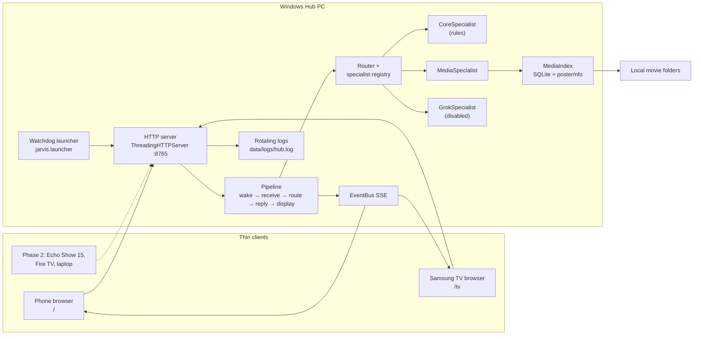

# Jarvis Hub architecture (phase 1)

The hub is a single Python process on the Windows desktop. Phones, the
Samsung TV browser, and (later) Echo Show, Fire TV, and a laptop are
**thin clients**: they send text commands and render replies. All
indexing, routing, and (future) device control live on the hub.

## Components



Config is a JSON file (`config.json`, override with `JARVIS_CONFIG`).
The media database and logs live under `data_dir`.

## Command pipeline

Every `POST /api/command` walks five named stages. The response includes
a `stages` object so you can see the plumbing work:

1. **Wake** — If the text starts with the configured wake word
   (`jarvis, …`), the prefix is stripped. A bare wake word becomes
   `hello`. Typed input is accepted with or without the prefix.
2. **Receive** — Normalize whitespace, record `source` and `client_id`.
3. **Route** — The router asks each **enabled** specialist, in priority
   order, whether it `can_handle` the text. The first yes wins.
4. **Reply** — That specialist's `handle()` returns `{reply, intent, data}`.
   If none match, a polite unknown-command fallback is used.
5. **Display** — The EventBus publishes the reply. Every connected
   client subscribed to `GET /api/events` (phone and TV) updates live.
   The originating HTTP response also carries the same body.

## Specialist plug-in interface

```python
class Specialist:
    name = "example"
    priority = 50          # lower runs first; catch-alls should be high
    enabled = True

    def can_handle(self, text: str, context: dict) -> bool: ...
    def handle(self, text: str, context: dict) -> dict:
        return {"reply": "...", "intent": "example.do", "data": {}}
```

Register new specialists in `jarvis.router.build_default_router`.

| Specialist        | Phase | Role |
| ----------------- | ----- | ---- |
| `CoreSpecialist`  | 1     | Greetings, time/date, help, system status |
| `MediaSpecialist` | 1     | Find / list / resolve play-on-TV (stub action) |
| `GrokSpecialist`  | 2     | Present but `enabled = False`. Catch-all Grok API chat. |
| Home automation   | later | **Do not** wire Home Assistant or MQTT in phase 1. |
| Calendar          | later | Upcoming household events. |
| Richer media / TV | 2     | Actual playback via TV root control. |

### Where TV root control attaches

In `jarvis/specialists/media.py`, inside `_play()`, a clearly marked
`TODO(phase-2)` comment sits immediately after a title has been resolved
to a file path. That is the attach point for the `samsung-tv-root`
project: push the path to the rooted QN75QN800D and start playback.
Phase 1 only returns `action: "would_play"` and does not stream video
(the `/api/media/<id>/stream` route is a 501 hook).

### Where the Grok API attaches

`jarvis/specialists/grok.py` is the placeholder. In phase 2 it should
become a low-priority catch-all (`priority` ≈ 900), enabled only when an
API key is configured, so the hub still works offline for the rule-based
commands.

## Thin clients

All clients are browsers or future lightweight shells against the same
HTTP API. None of them hold the media library or the router.

| Client | Phase 1 path | Notes |
| ------ | ------------ | ----- |
| Phone browser | `/` | Chat UI, media grid, Web Speech mic when the context is secure. |
| Samsung TV (Tizen Internet app) | `/tv` | 10-foot remote UI, spatial D-pad nav, Back key `10009`. No mic. |
| Echo Show 15 | phase 2 | Voice remote / skill or a hosted page; not built here. |
| Fire TV | phase 2 | Voice remote or a Leanback-style page; not built here. |
| Laptop | phase 2 | A fuller desktop client or the same phone page in a window. |

The EventBus is how a command issued on the phone can show up on the TV
(and the other way around) without polling.

## Media index

- Recursive scan of `media_paths` for `mkv mp4 avi m4v mov wmv ts`.
- Title and year parsed from filenames and folder names
  (`Movie.Name.2010.1080p.BluRay.x264`, `Movie Name (2010)`, …).
- Kodi-style `.nfo` XML (`movie.nfo` or `<stem>.nfo`) supplies title,
  year, plot, and genres when present.
- Sidecar art: `poster.jpg`, `folder.jpg`, `<name>-poster.jpg`,
  `<name>.jpg`, `cover.jpg`, plus `.png` / `.jpeg` / `.webp`.
- Stored in SQLite (`data/media.sqlite3`). Incremental rescans compare
  video and sidecar mtimes and prune missing files.
- A background scan starts with the server. `POST /api/media/rescan`
  triggers another.
- Fuzzy resolution uses `difflib.SequenceMatcher` plus substring
  bonuses, so "play inception on the tv" can hit `Inception (2010)`.
- Poster bytes are served only if that path is the one stored on the
  indexed row. No general file-read API.

## Process model on Windows

```
Task Scheduler (AtStartup, run whether logged on or not)
  └─ pythonw -m jarvis.launcher     # watchdog, exponential backoff
       └─ pythonw -m jarvis.server  # HTTP + indexer
```

The launcher treats a zero exit as a clean stop and any other exit as a
crash worth restarting. Task Scheduler's own "restart on failure" is a
second safety net. Health is exposed at `GET /api/health`.

## Security notes

- Bind defaults to `0.0.0.0` so the LAN can connect, but the service is
  designed for a **private LAN only**. The installer firewall rule allows
  the dashboard port on the **Private** profile and nowhere else.
- There is no cloud dependency and no outbound API call in phase 1.
- An optional `auth_token` in `config.json` requires `X-Hub-Token` (or
  `Authorization: Bearer …`, or `?token=`) on API requests. The
  dashboard can store the token in `localStorage` as `jarvis_token`.
  This is a shared household secret, not a per-user login.
- The HTTP server refuses path traversal out of `web/` and will not
  read arbitrary disk files for posters.
- Optional HTTPS (self-signed) exists so a phone can use the Web Speech
  mic. Trusting a self-signed cert is a manual step; keyboard dictation
  still works over HTTP.
- Do not port-forward 8765. Do not put the hub on a public interface.
