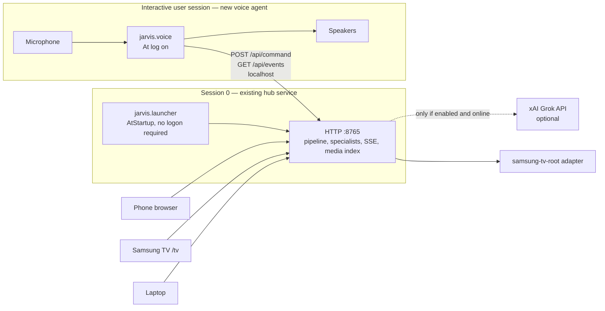

# Jarvis Hub — Phase 2 design

This document is a design only. It does not change phase 1 code. Phase 2
implementation should plug into the existing command pipeline, specialist
registry, SSE bus, and the marked hooks in the media specialist and the
`/api/media/<id>/stream` 501 route. The hub stays a LAN service on the
Windows PC (`C:\JarvisHub`, port 8765 by default). Core function must
keep working if the internet or the Grok API is down.

Researched November 2026. Recheck vendor pricing, model IDs, and plan
terms before buying or integrating; do not treat figures in third-party
summaries as current unless you have opened the official page.

## Contents

1. [Architecture overview](#1-architecture-overview)
2. [Wake word, speaker verification, and speech-to-text](#2-wake-word-speaker-verification-and-speech-to-text)
3. [Talkback (text-to-speech)](#3-talkback-text-to-speech)
4. [Grok API specialist](#4-grok-api-specialist)
5. [TV playback: `TVController`, HTTP Range streaming, DLNA fallback](#5-tv-playback-tvcontroller-http-range-streaming-dlna-fallback)
6. [Echo Show 15 and Fire TV clients](#6-echo-show-15-and-fire-tv-clients)
7. [Laptop client](#7-laptop-client)
8. [Phone-to-TV file transfer](#8-phone-to-tv-file-transfer)
9. [Security notes (mic, audio, LAN, uploads, keys)](#9-security-notes-mic-audio-lan-uploads-keys)
10. [Proposed `config.json` additions](#10-proposed-configjson-additions)
11. [Implementation order](#11-implementation-order)
12. [Open questions](#12-open-questions)
13. [Sources](#13-sources)

---

## 1. Architecture overview

Phase 1 already runs an always-on HTTP process that can start at boot
and stay up with nobody logged in. That process must **not** grow a
microphone. On Windows, a Task Scheduler task set to “run whether the
user is logged on or not” (including `SYSTEM`) runs in Session 0. Session 0
is isolated from the interactive desktop and does not reliably see the
logged-on user’s capture or render devices. Microsoft documents this
isolation for services, and audio libraries fail in the same way when
launched from a non-interactive scheduled task.



**Process split (required):**

| Process | Scheduled task | Session | Role |
| --- | --- | --- | --- |
| Existing hub (`python -m jarvis.launcher`) | At startup, run whether logged on or not | Session 0 is fine | HTTP, index, Grok, streaming, uploads |
| New voice agent (`python -m jarvis.voice`) | **At log on**, “run only when user is logged on” | Interactive session | Mic, wake word, speaker check, STT, TTS |

The voice agent is a thin client of the hub, just like the phone and the
TV: it `POST`s `{text, source: "hub-mic", client_id}` to
`/api/command` and subscribes to `/api/events` to speak replies. The
router, specialists, and display fan-out stay in one place.

If the household wants voice immediately after a power cut, the PC must
reach an interactive logon without someone typing a password. Windows
can do that with [Sysinternals Autologon](https://learn.microsoft.com/en-us/sysinternals/downloads/autologon)
or the built-in automatic-logon policy. The password is stored as an
LSA secret; an administrator can recover it. That is a real tradeoff and
should be an explicit choice, not a silent default.

---

## 2. Wake word, speaker verification, and speech-to-text

### 2.1 What “Patrick’s voice specifically” actually requires

A wake-word engine answers “did someone say the phrase?” It is **not**
speaker verification. Training or fine-tuning a wake word on Patrick’s
recordings can make the phrase detector more reliable for his accent; it
will not reliably reject another person (or the TV) saying “Jarvis” or
“Hey Jarvis.” Picovoice’s own FAQ treats these as two products (Porcupine
for the phrase, Eagle for the speaker). openWakeWord’s included models
are likewise phrase models with published false-accept targets, not
voice IDs.

**Recommendation:** run three stages after the mic stream, in this order:

1. **Wake word** (always-on, cheap, offline) — start of utterance.
2. **Capture the following command** (1–8 seconds, VAD or a fixed window).
3. **Speaker verification** on that longer clip (and optionally on the
   wake snippet) against an enrollment profile for Patrick.
4. **Speech-to-text** on the same clip, then `POST /api/command`.

If the speaker check fails, do not transcribe by default, do not send
audio off the machine, and optionally play a short local “ignored”
tone. Tune the cosine threshold on the real room: a tight threshold
reduces false accepts from family or the television and increases
false rejects when Patrick has a cold, is far from the mic, or talks
over a movie.

### 2.2 Wake word: openWakeWord vs Porcupine

| | [openWakeWord](https://github.com/dscripka/openWakeWord) | [Picovoice Porcupine](https://picovoice.ai/docs/porcupine/) |
| --- | --- | --- |
| Household fit | Good. Code is Apache 2.0. Included English models (including **“hey jarvis”**) are [CC BY-NC-SA 4.0](https://creativecommons.org/licenses/by-nc-sa/4.0/), which covers personal non-commercial use. | Poor for a private household in late 2026. Picovoice’s FAQ states there are **no dedicated free or paid plans for personal or non-commercial use**. A May 2026 maintainer reply says Free Tier AccessKeys were disabled on 30 June 2026 and that no non-commercial tier is planned. |
| Offline at runtime | Yes. After models are downloaded, inference is local (ONNX Runtime on Windows). | Audio is processed on-device, but an **AccessKey is required** and is **validated when the engine is initialized**, and is also used to enforce plan limits. The SDK does not run without a valid key, so initialization depends on Picovoice’s license service (internet at least at start). |
| Custom wake word | Official [Colab](https://colab.research.google.com/drive/1q1oe2zOyZp7UsB3jJiQ1IFn8z5YfjwEb?usp=sharing) and a more detailed training notebook. Synthetic positives (thousands recommended) plus negative data. English-focused today. | Custom `.ppn` models via [Picovoice Console](https://picovoice.ai/docs/quick-start/porcupine-python/). Still bound to an AccessKey and a current commercial plan. |
| Windows / Python | `pip install openwakeword` (PyPI 0.6.0, Python ≥ 3.7). On Windows only ONNX Runtime is installed (no modern TFLite). Example mic code may pull `PyAudioWPatch`. | `pip install pvporcupine` (PyPI 4.0.3, Python ≥ 3.9). Official docs list Windows x86_64 and arm64. |
| CPU | Designed to be small; official FAQ says it is not aimed at very low-power MCUs, which is irrelevant on this 32 GB desktop. Always-on cost is far below STT. | Very lightweight; historically strong on-device accuracy. The license, not the CPU, is the blocker. |

**Choice: openWakeWord.** Start with the included `hey jarvis` model
(threshold-tuned in the real room; the project aims for under 5%
false-rejects and under 0.5 false-accepts per hour with appropriate
thresholds). If a different phrase is preferred, train a custom model
with the official notebooks and then re-tune. Personal household use of
the included models is compatible with CC BY-NC-SA; do not redistribute
those model files commercially, and review training-data licenses if a
custom model is trained from the official pipelines (the included models
use restrictive or unknown-license datasets; the published models were
trained with on the order of 30,000 hours of negative audio).

Do not plan on Porcupine for this house unless Picovoice later publishes
a personal plan you are willing to pay for and an AccessKey workflow
you accept. Recheck [Picovoice pricing](https://picovoice.ai/pricing/)
and the [FAQ](https://picovoice.ai/docs/faq/general/) before revisiting
that choice. This design does not quote dollar amounts from the pricing
page because the live page is client-rendered and could not be reliably
extracted here.

### 2.3 Speaker verification (the “Patrick only” layer)

Two solid, offline, Apache-licensed options:

- **[SpeechBrain](https://speechbrain.readthedocs.io/) ECAPA-TDNN** —
  package [speechbrain](https://pypi.org/project/speechbrain/) 1.1.2 is
  Apache-2.0. The pretrained [`speechbrain/spkrec-ecapa-voxceleb`](https://huggingface.co/speechbrain/spkrec-ecapa-voxceleb)
  model is also Apache-2.0. Download once, then load from a local
  directory so runtime stays offline.
- **[Resemblyzer](https://github.com/resemble-ai/Resemblyzer)** —
  Apache-2.0. Embed several enrollment clips, average and L2-normalize,
  then score new audio with cosine similarity.

**Choice: SpeechBrain ECAPA as primary**, Resemblyzer as a smaller
fallback if the SpeechBrain stack is too heavy for a first slice.
Enrollment lives only under `data/voice/enrollments/` (several 5–15 s
clips of Patrick, recorded on the *same* hub mic, in the *same* room).
Never upload enrollment audio. Re-enroll if the mic or room changes.

Expect errors both ways. Report scores in a local debug log (not to
SSE by default) so the threshold can be adjusted.

### 2.4 Speech-to-text after wake

The 8 GB VRAM GPU is enough for a modern Whisper runtime.

- **[faster-whisper](https://github.com/SYSTRAN/faster-whisper)** (MIT) —
  recommended. `pip install faster-whisper`, Python ≥ 3.9. GPU use
  needs NVIDIA **cuBLAS for CUDA 12** and **cuDNN 9 for CUDA 12**. Official
  benchmarks on an RTX 3070 Ti 8 GB show `large-v2` at int8 using about
  2926 MB VRAM; fp16 is about 4525 MB. That fits this card. For
  short commands, start with a smaller model (`small`, `medium`, or
  `turbo`) for latency, and make the size a config key. `int8_float16`
  is a sensible GPU default.
- **[whisper.cpp](https://github.com/ggerganov/whisper.cpp)** —
  strong C++ alternative with CUDA; more of a build step on Windows.
  Fine as a later swap, not the first integration.
- **[Vosk](https://github.com/alphacep/vosk-api)** (Apache 2.0) —
  fully offline, CPU-friendly, useful as a fallback when CUDA is
  missing. Accuracy on conversational English is typically behind
  Whisper-class models. Keep it as a config-selectable backend, not
  the default.

Do not stream microphone audio to a cloud STT service in the default
path. The point of a local hub is that the always-on mic stays on the
PC.

### 2.5 Microphone capture

Prefer **[sounddevice](https://python-sounddevice.readthedocs.io/)**
(PyPI 0.5.6, MIT, PortAudio, Windows wheels). Use 16-bit mono 16 kHz
frames (openWakeWord wants 16 kHz PCM, frames that are multiples of
80 ms). `PyAudio` / `PyAudioWPatch` is acceptable if a dependency
already needs it; do not add both without a reason.

List devices at startup and let `voice.input_device` select the mic
by name or index so a USB mic can be pinned.

### 2.6 Windows install and config (voice stack)

Run these in the **logged-on user** account, in a venv, not as SYSTEM.

```powershell
cd C:\JarvisHub
py -3 -m venv .venv
.\.venv\Scripts\Activate.ps1
python -m pip install --upgrade pip
python -m pip install openwakeword sounddevice faster-whisper speechbrain
# CUDA: install NVIDIA cuBLAS + cuDNN 9 for CUDA 12 per the faster-whisper README
python -c "import openwakeword; openwakeword.utils.download_models()"
```

Then enroll Patrick (a small helper script in phase 2, not built yet):
record several clips, write embeddings under `data/voice/enrollments/`.

Create a scheduled task **At log on** for that user, “run only when
the user is logged on,” action
`C:\JarvisHub\.venv\Scripts\python.exe -m jarvis.voice`, start in
`C:\JarvisHub`. Do not use the existing `install_service.ps1` for this
process.

Mute, threshold, and device keys go in `config.json` (see
[section 10](#10-proposed-configjson-additions)).

### 2.7 Pipeline plug-in

The voice agent does wake / verify / transcribe **before** the existing
pipeline. It then calls the same `POST /api/command` contract:

```json
{"text": "play inception on the tv", "source": "hub-mic", "client_id": "hub-voice"}
```

Optional leading `jarvis,` in the transcript is already stripped by the
phase 1 wake stage. SSE `reply` events with `source=hub-mic` (and, if
configured, replies from any client) go to TTS. The specialist registry
does not need a new “voice” specialist.

---

## 3. Talkback (text-to-speech)

The hub should speak replies through the PC’s speakers or a chosen
output device. Compare:

| Option | Offline? | Quality | Notes |
| --- | --- | --- | --- |
| **Windows SAPI 5** via `pyttsx3` or `win32com` / `comtypes` | Yes | System voices, often robotic | [pyttsx3](https://pypi.org/project/pyttsx3/) 2.99 is MPL-2.0 and uses SAPI5 on Windows with no network. Good fallback. Same Session 0 limitation: it must run in the interactive session. |
| **pyttsx3** | Yes (SAPI on Windows) | Same as SAPI | Thin wrapper; simplest fallback API. |
| **[edge-tts](https://github.com/rany2/edge-tts)** | **No** | High-quality neural voices | Talks to Microsoft Edge’s online TTS. Most of the project is LGPLv3. Reject as the default: it sends reply text to a cloud service and fails offline. |
| **[Piper](https://github.com/OHF-Voice/piper1-gpl)** | Yes, after the voice is downloaded | Neural, local | PyPI [`piper-tts`](https://pypi.org/project/piper-tts/) 1.8.0 is **GPL-3.0-or-later**, Python ≥ 3.9, official Windows x86-64 wheels. `pip install piper-tts` then `python -m piper.download_voices en_US-lessac-medium`. Check each voice’s model card/license before bundling. |

**Choice: Piper first, SAPI / pyttsx3 fallback.** Download a voice once
while online; synthesis stays local. If Piper is missing or a voice file
is absent, fall back to SAPI so talkback still works. Select the output
device with `voice.output_device`. Do not speak while the wake-word
loop is mid-capture (duck or pause the mic) to avoid the hub triggering
itself.

The voice agent subscribes to SSE, speaks `reply` text, and can also
expose a small `POST /api/speak` later if the hub process wants to
push talkback. Prefer SSE so every specialist’s reply is spoken the
same way.

Windows install (same venv as the voice agent):

```powershell
python -m pip install piper-tts pyttsx3
python -m piper.download_voices en_US-lessac-medium --data-dir C:\JarvisHub\data\voices
```

---

## 4. Grok API specialist

Phase 1 already ships a disabled `GrokSpecialist` (`priority` 900,
`enabled = False`) in `jarvis/specialists/grok.py`, registered from
`build_default_router`. Phase 2 turns it into a real catch-all: core
and media still win first; anything they decline can go to Grok when
configured and reachable.

### Official API (verified)

- Docs: [Quickstart](https://docs.x.ai/developers/quickstart),
  [Responses overview](https://docs.x.ai/docs/overview),
  [Tools](https://docs.x.ai/developers/tools/overview),
  [Function calling](https://docs.x.ai/developers/tools/function-calling),
  [Chat Completions (legacy)](https://docs.x.ai/developers/model-capabilities/legacy/chat-completions).
- Base URL: `https://api.x.ai/v1`.
- Auth: `Authorization: Bearer $XAI_API_KEY`. Create the key in the
  [xAI console](https://console.x.ai) and export it as an environment
  variable; the official quickstart uses `XAI_API_KEY`.
- Preferred endpoint: **`POST https://api.x.ai/v1/responses`**. Official
  docs present Chat Completions (`/v1/chat/completions`) as the legacy,
  OpenAI-compatible predecessor. New work should use Responses. The
  OpenAI Python SDK still works with `base_url="https://api.x.ai/v1"`.
- The current official quickstart examples use model id **`grok-4.7`**.
  Treat that as “what the docs showed when this was written,” and make
  the model a config key so it can change without a code rewrite. Check
  the [models catalog](https://docs.x.ai/docs/overview) at implementation
  time. This design does not quote prices.

### Behavior

- **Enable** only when a key is present (env `XAI_API_KEY`, optionally
  pointed at by config). If the key is missing, keep `enabled = False`
  and behave as phase 1.
- **Timeouts:** a short connect timeout and a bounded read timeout
  (config; start around 15–30 s for ordinary chat). On timeout, DNS
  failure, HTTP 5xx, or 401, return a local apology and let the user
  retry; do not hang the dashboard.
- **Offline fallback:** rule-based specialists already ran. If Grok
  cannot be reached, reply that the cloud assistant is unavailable and
  that local commands (help, time, library, play) still work. Never
  fail the whole hub because Grok is down.
- **Conversation context:** keep a short in-memory ring buffer per
  `client_id` (last N turns, token-capped). Do not persist chats to
  disk by default. The Responses API can continue a stored turn with
  `previous_response_id`; prefer sending a compact local history so
  the hub does not depend on server-side storage (officially kept 30
  days when `store` is on).
- **Tool / function calling:** define **local** tools that wrap existing
  specialists (`play_media`, `search_media`, `list_library`,
  `hub_status`, later `start_transfer`). The model should request the
  tool; the hub executes it locally (same code paths as typed commands)
  and returns the result. See the official function-calling guide.
- **Built-in xAI tools** (`web_search`, `x_search`, `code_interpreter`,
  …) run on the provider’s servers and should stay **opt-in and off by
  default** so household questions are not sent to extra cloud tools
  unless Patrick chooses that.

Keep the default HTTP client on the standard library if possible
(`urllib.request`) so the hub process does not have to take the
`openai` package. The SDK is an optional convenience.

The specialist returns the usual `{reply, intent: "grok.chat", data}`
dict. The pipeline’s display stage already broadcasts on SSE, so the
phone, TV, and voice agent all see (and can speak) the answer.

---

## 5. TV playback: `TVController`, HTTP Range streaming, DLNA fallback

The phase 1 hook sits in `MediaSpecialist._play()` after a title has
been resolved to a path, and `/api/media/<id>/stream` currently returns
501. Phase 2 should implement both, without baking in one undocumented
root-tooling layout. The `samsung-tv-root` project is external; treat
it as a plug-in. Phase 3 adds local, no-root power and HDMI control via samsungtvws; see [PHASE3_DESIGN.md](PHASE3_DESIGN.md).

### Adapter

```python
class TVController:
    def status(self) -> dict: ...
    def play_path(self, path: str, metadata: dict) -> dict: ...
    def play_url(self, url: str, metadata: dict) -> dict: ...
    def pause(self) -> dict: ...
    def resume(self) -> dict: ...
    def stop(self) -> dict: ...
    def set_volume(self, level: int) -> dict: ...
```

A `SamsungTvRootController` implements this by calling into whatever
CLI, HTTP, or ADB-like interface `samsung-tv-root` exposes on the
QN75QN800D. A `DlnaController` (or “Play To”) is a non-root fallback
for TVs that can pull a LAN URL or a DLNA item. A `NullController`
keeps today’s “would play” behavior when nothing is configured.

`_play()` becomes: resolve title → build a stream URL on the hub →
`controller.play_url(...)` (preferred, because the TV often cannot see
a raw `D:\Movies\...` path) or `play_path` if the root environment
mounts the library. On success, return `action: "playing"` instead of
`would_play`, and publish an SSE `media` event so every client updates.

### HTTP Range streaming

Implement `GET /api/media/<id>/stream` as a **Range-capable** file
response (`Accept-Ranges: bytes`, `206 Partial Content`) restricted to
indexed media ids, same safety rule as posters: never an arbitrary path.
Optional later: a short-lived signed token in the query string so the
TV player can fetch without a custom header. Do not transcode in
phase 2 unless a trial on the Tizen player proves a format is
unplayable; this library is already local files the TV may accept as
MP4/MKV over HTTP.

The stream URL is LAN-only, same Private firewall profile as port 8765.

### DLNA / UPnP fallback

If root control is not ready, many Samsung TVs can still play a URL or
a DLNA item advertised on the LAN. Phase 2 should try, in order: root
adapter → “open this HTTP stream on the TV” if the root/tooling can
launch the TV browser or a player → DLNA/UPnP announcement of the
stream URL. Document failure clearly in the reply when none of them
work.

---

## 6. Echo Show 15 and Fire TV clients

Goal: the same thin-client contract (`/`, `/tv`, `/api/command`,
`/api/events`). No second brain on those devices.

**Echo Show 15.** The practical local-only path is the Silk browser
pointed at `http://<hub-ip>:8765` or `/tv`. Household reports describe
opening Silk and typing a LAN URL (this is community practice, not a
first-party kiosk API). Expect the show to leave Silk after idle
timeouts; a bookmark and a voice routine (“open Silk”) are the honest
phase 2 UX, not a guaranteed always-on kiosk.

A real **Alexa custom skill** is a different and cloud-heavy path.
Amazon requires the skill endpoint to be **reachable on the public
internet, HTTPS on port 443, with a trusted certificate** (self-signed
only for testing). That means a tunnel or a hosted function. It breaks
the “core is LAN-only” rule and exposes a public ingress. Phase 2
should **not** make an Alexa skill the default. If it is ever added, it
must be an explicit opt-in with the cloud tradeoff called out.

**Fire TV.** Some devices can run Silk or another browser and load the
dashboard; this is uneven across Fire OS builds. The reliable thin
client is a small **sideloaded Fire TV / Android WebView app** that
loads `http://<hub-ip>:8765/tv` (10-foot page, D-pad already exists)
and is installed with `adb`. Amazon’s Fire TV hybrid-app documentation
covers WebView-style apps. A full native Leanback player can wait.

Voice on those devices, without a cloud skill, is limited to whatever
the on-screen keyboard or a future Web Speech context allows. The
Hub PC mic remains the household “always listening” device.

---

## 7. Laptop client

Two layers, both thin:

1. **Browser** — the existing phone page at `http://<hub-ip>:8765` in a
   window or a pinned PWA / “install as app” shortcut. This should be
   week-one work: a desktop shortcut and a short README section. Mic
   on the laptop still needs HTTPS or localhost; keyboard dictation
   works on HTTP.
2. **Optional tray app** — a small Python or WebView2 helper in the
   logged-on session: tray icon, “open dashboard,” mute/unmute of the
   *hub* voice agent (via a localhost API), last reply, maybe global
   hotkey to push-to-talk. No second media index and no second router.

---

## 8. Phone-to-TV file transfer

Fold this into phase 2 as a hub-mediated inbox, not a phone-to-TV
peer protocol.

1. The phone page gets a drag-and-drop / file-picker zone
   (`POST /api/transfers`, `multipart/form-data`).
2. The hub stores the file under `data/transfers/` with a generated
   id, records metadata in SQLite, and rejects anything over
   `transfers.max_bytes` (config; start at a few hundred MB to 2 GB,
   not unlimited).
3. Validate: extension and sniff of a short magic-byte allowlist
   (common video/image/audio types first), no path characters in the
   submitted name, no execution of the file on the hub.
4. SSE `transfer` event so the TV page can show an “incoming” tile.
5. Play or present on the TV through `TVController.play_url` of
   `GET /api/transfers/<id>/stream` (same Range rules as media), or
   a “save into the library and rescan” action.
6. TTL cleanup (config, e.g. 24–72 hours) and a manual delete
   endpoint. Do not keep uploads forever.

The phone never talks to the TV except through the hub.

---

## 9. Security notes (mic, audio, LAN, uploads, keys)

- **Always-on mic is local.** Wake word, speaker check, and default
  STT run on the Hub PC. Do not ship command audio to Grok or any
  other cloud STT in the default config. If a future “send this clip
  to the API” feature appears, it must be opt-in.
- **Do not retain recordings by default.** Keep only enrollment
  embeddings (and the enrollment wavs if Patrick wants to re-train,
  stored locally and deletable). Debug clips, if enabled, should live
  behind a flag and a short TTL.
- **Visible mute.** Hardware mute on the mic, plus a software mute
  hotkey / tray / dashboard toggle that the voice agent honors
  immediately, and a clear “listening / muted” indicator (LED, tray
  icon, or a small always-on-top widget).
- **Session boundary.** Never attach the mic to the Session 0 service.
- **Auth.** Phase 1’s single `auth_token` is a household secret.
  Phase 2 should add **per-device tokens** (phone, TV, laptop, voice
  agent, transfer client) stored as hashes, rotatable, sent as
  `X-Hub-Token`. The voice agent uses a localhost token. SSE and
  uploads must require the same auth when tokens are enabled.
- **HTTPS** for the phone mic and for upload in untrusted-network
  stories. On a clean private LAN, HTTP plus keyboard dictation
  remains acceptable; the phase 1 self-signed cert scripts still
  apply. Do not port-forward 8765.
- **Firewall.** Keep the existing Private-profile rule. Do not add
  Public or any WAN allow.
- **Uploads.** Size cap, type allowlist, generated names, TTL, no
  execute permission on `data/transfers/`.
- **Streaming.** Only indexed or transfer ids; Range requests must
  not be usable as a general file-read primitive.
- **API keys.** `XAI_API_KEY` in the user or service environment, not
  committed, not in the dashboard JSON, not logged. If a Picovoice
  key is ever used, same rule.
- **Windows mic permission.** Grant the voice-agent Python the
  microphone privacy permission
  (`Settings → Privacy & security → Microphone`) for the logged-on
  user. Autologon stores a password: use it only if the PC is in a
  locked house and the account is not a shared admin with mail and
  banking in the same profile.
- **Grok tools.** Default off for provider-side search/code tools.
  Local function tools only execute existing hub actions.

---

## 10. Proposed `config.json` additions

Phase 1 keys stay as they are. Phase 2 should add a block along these
lines (names can be bikeshed at implementation time):

```json
{
  "voice": {
    "enabled": true,
    "wake_engine": "openwakeword",
    "wake_model": "hey jarvis",
    "wake_threshold": 0.5,
    "speaker_engine": "ecapa",
    "speaker_threshold": 0.65,
    "enrollments_dir": "data/voice/enrollments",
    "stt_engine": "faster-whisper",
    "stt_model": "small",
    "stt_device": "cuda",
    "stt_compute_type": "int8_float16",
    "tts_engine": "piper",
    "tts_voice": "en_US-lessac-medium",
    "tts_voices_dir": "data/voices",
    "tts_fallback": "sapi",
    "input_device": "",
    "output_device": "",
    "speak_sources": ["hub-mic"],
    "retain_recordings": false,
    "mute": false
  },
  "grok": {
    "enabled": true,
    "api_key_env": "XAI_API_KEY",
    "base_url": "https://api.x.ai/v1",
    "model": "grok-4.7",
    "timeout_seconds": 30,
    "history_turns": 8,
    "provider_tools": false
  },
  "tv": {
    "controller": "samsung-tv-root",
    "controller_options": {},
    "stream_token_ttl_seconds": 300
  },
  "transfers": {
    "dir": "data/transfers",
    "max_bytes": 1073741824,
    "ttl_hours": 48,
    "allowed_extensions": [".mp4", ".mkv", ".webm", ".jpg", ".png", ".mp3"]
  },
  "auth_tokens": {
    "phone": "",
    "tv": "",
    "laptop": "",
    "voice": "",
    "transfers": ""
  }
}
```

Leave `auth_token` for backward compatibility until per-device tokens
are live.

---

## 11. Implementation order

Milestones are sequential where they depend on each other; 2 and 4 can
overlap.

1. **Voice agent process + TTS.** New `jarvis.voice`, At-log-on task,
   Piper with SAPI fallback, SSE talkback of `hub-mic` (and typed
   localhost test commands). Proves the Session 0 split before any
   always-on listening.
2. **Grok specialist.** Enable the placeholder, env key, timeouts,
   local fallback, short history, local function tools. Independent of
   the mic; high user-visible value on phone and TV immediately.
3. **Wake word + STT.** openWakeWord `hey jarvis`, sounddevice, then
   faster-whisper on CUDA. End-to-end “Hey Jarvis, what’s the time?”
   through the existing pipeline.
4. **Speaker verification.** ECAPA enrollment for Patrick, threshold
   tuning in the real room, mute and listening indicator.
5. **HTTP Range streaming + `TVController`.** Implement
   `/api/media/<id>/stream`. Wire `_play()` to the adapter. Add a
   DLNA or URL-launch fallback if root tooling is not ready.
6. **`samsung-tv-root` adapter.** Fill in `SamsungTvRootController`
   against the actual project interface once that path is available
   on the QN75QN800D.
7. **Phone-to-TV transfers.** Upload, cap, TTL, TV inbox, play via
   the same controller/stream path.
8. **Laptop client.** Shortcut / PWA first; tray mute helper second.
9. **Echo Show 15 and Fire TV.** Silk / WebView to `/tv`; document
   idle-timeout limits; no Alexa skill unless the cloud tradeoff is
   accepted later.
10. **Hardening.** Per-device tokens, optional LAN HTTPS default, log
    redaction, recording-retention flag default off.

Phase 2 still does **not** include Home Assistant, MQTT, or general
smart-home device control.

---

## 12. Open questions

- Confirm the spoken phrase: the included model is **“hey jarvis”**.
  Is a custom phrase (“Jarvis”, a nickname) worth training?
- How strict should speaker verification be? Patrick only, or also
  enroll Katie / others?
- Is Windows Autologon acceptable on this PC so voice works after a
  reboot with nobody at the keyboard?
- Which audio devices should be the default mic and talkback speaker?
- Which Grok model should be the configured default after a fresh look
  at the catalog? Are provider-side tools (`web_search`, etc.) ever
  wanted?
- Where does `samsung-tv-root` live on the hub or the TV, and what
  control surface does it actually expose (CLI, HTTP, ADB, …)?
- What is a comfortable upload cap, and should transfers auto-delete
  after play?
- Should the hub speak replies that originated on the phone or TV, or
  only commands heard at the hub mic?
- Fire TV: is sideloading a WebView APK acceptable, or is a browser
  bookmark the only wanted path?
- Alexa skill: confirm it stays out unless a public HTTPS endpoint is
  later accepted.

---

## 13. Sources

- openWakeWord: [GitHub README](https://github.com/dscripka/openWakeWord) (installation, “hey jarvis” model, training notebooks, Apache 2.0 code, CC BY-NC-SA 4.0 included models, Windows ONNX Runtime).
- Porcupine: [Python quick start](https://picovoice.ai/docs/quick-start/porcupine-python/), [Porcupine docs](https://picovoice.ai/docs/porcupine/), [GitHub](https://github.com/Picovoice/porcupine), [PyPI pvporcupine 4.0.3](https://pypi.org/project/pvporcupine/).
- Picovoice licensing: [FAQ (“no dedicated free or paid plans for personal or non-commercial use”)](https://picovoice.ai/docs/faq/general/), [GitHub issue #1574](https://github.com/Picovoice/porcupine/issues/1574) (Free Tier AccessKeys disabled 30 June 2026; AccessKey validated at initialization; no non-commercial tier planned), [pricing page](https://picovoice.ai/pricing/) (recheck live figures).
- SpeechBrain: [PyPI speechbrain 1.1.2, Apache-2.0](https://pypi.org/project/speechbrain/), [ECAPA model, Apache-2.0](https://huggingface.co/speechbrain/spkrec-ecapa-voxceleb), [speaker inference docs](https://speechbrain.readthedocs.io/en/latest/API/speechbrain.inference.speaker.html).
- Resemblyzer: [GitHub, Apache-2.0](https://github.com/resemble-ai/Resemblyzer).
- faster-whisper: [GitHub README](https://github.com/SYSTRAN/faster-whisper) (MIT; CUDA 12 / cuDNN 9; VRAM figures on an 8 GB RTX 3070 Ti).
- Vosk: [vosk-api](https://github.com/alphacep/vosk-api) (`COPYING` is Apache 2.0), [PyPI vosk](https://pypi.org/project/vosk/).
- sounddevice: [docs](https://python-sounddevice.readthedocs.io/), [PyPI 0.5.6, MIT](https://pypi.org/project/sounddevice/).
- Piper: [OHF-Voice/piper1-gpl](https://github.com/OHF-Voice/piper1-gpl), [PyPI piper-tts 1.8.0, GPL-3.0-or-later](https://pypi.org/project/piper-tts/), [CLI docs](https://github.com/OHF-Voice/piper1-gpl/blob/main/docs/CLI.md).
- pyttsx3: [PyPI 2.99, MPL-2.0](https://pypi.org/project/pyttsx3/).
- edge-tts: [GitHub](https://github.com/rany2/edge-tts) (LGPLv3 for most files; Microsoft Edge online TTS).
- xAI / Grok API: [Quickstart](https://docs.x.ai/developers/quickstart), [Get started / Responses](https://docs.x.ai/docs/overview), [Tools overview](https://docs.x.ai/developers/tools/overview), [Function calling](https://docs.x.ai/developers/tools/function-calling), [legacy Chat Completions](https://docs.x.ai/developers/model-capabilities/legacy/chat-completions).
- Windows audio / logon: [Interactive services / Session 0](https://learn.microsoft.com/en-us/windows/win32/services/interactive-services), [Sysinternals Autologon](https://learn.microsoft.com/en-us/sysinternals/downloads/autologon), [automatic logon](https://learn.microsoft.com/en-us/troubleshoot/windows-server/user-profiles-and-logon/turn-on-automatic-logon).
- Alexa skill hosting: [Host a custom skill as a web service](https://developer.amazon.com/en-US/docs/alexa/custom-skills/host-a-custom-skill-as-a-web-service.html) (public internet, HTTPS port 443, trusted cert).
- Fire TV WebView apps: [HTML5 hybrid app FAQ](https://developer.amazon.com/docs/fire-tv/web-hybrid-app-faq.html).
