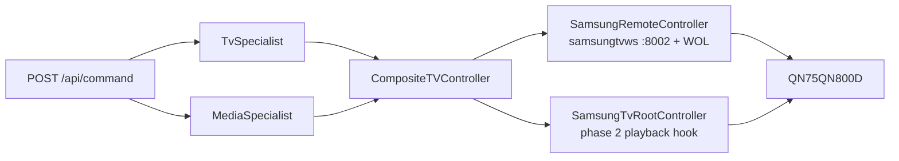

# Jarvis Hub — Phase 3 design

Samsung TV full control for the household **QN75QN800DFXZA** (2024
75" Neo QLED 8K, Tizen) using Samsung’s **local network remote
protocol**, with no TV root required for power and HDMI input.

Phase 2 already designs a `TVController` interface and a
`samsung-tv-root` hook for launching local movie files. Phase 3
**composes** with that work: the WebSocket remote handles power, input,
and keys; the root hook (and/or HTTP Range streaming from phase 2)
handles playback of library files. This document is design only. It
does not change phase 1 or phase 2 code.

Researched November 2026. HDMI key behavior must be verified on this
exact TV; see [confidence notes](#8-confidence-notes).

## Contents

1. [Library and protocol](#1-library-and-protocol)
2. [Power off, power on, and Wake-on-LAN](#2-power-off-power-on-and-wake-on-lan)
3. [HDMI and named inputs](#3-hdmi-and-named-inputs)
4. [Architecture and `TVController` composition](#4-architecture-and-tvcontroller-composition)
5. [TV specialist, voice, and pipeline plug-in](#5-tv-specialist-voice-and-pipeline-plug-in)
6. [Config, Windows install, and TV settings](#6-config-windows-install-and-tv-settings)
7. [Error handling, security, and test plan](#7-error-handling-security-and-test-plan)
8. [Confidence notes](#8-confidence-notes)
9. [Milestones](#9-milestones)
10. [Sources](#10-sources)
11. [Dual-orb TV interface and mic-node handoff](#11-dual-orb-tv-interface-and-mic-node-handoff)
12. [Nighttime Reolink person detection](#12-nighttime-reolink-person-detection)
13. [Security scanning](#13-security-scanning)

---

## 1. Library and protocol

**Choice: [samsungtvws](https://pypi.org/project/samsungtvws/)**
([GitHub: xchwarze/samsung-tv-ws-api](https://github.com/xchwarze/samsung-tv-ws-api)),
a Python wrapper for the post-2016 Tizen WebSocket / REST remote APIs.
Verified from PyPI and the project README (November 2026):

| | |
| --- | --- |
| PyPI version | **3.0.7** |
| License | **LGPL-3.0** |
| Python | **≥ 3.10** (matches the hub) |
| Core dependencies | `websocket-client`, `requests`, `yarl` |
| Optional extras | `async`, `encrypted` (older Orsay TVs, not needed here), `cli` (`typer` + `wakeonlan`) |

This is the **first non-stdlib dependency for the hub process
itself**. Phase 1 is standard library only. Phase 2 already planned
optional packages for the separate voice agent (openWakeWord, Piper,
faster-whisper). `samsungtvws` would be an **optional extra** of the
core service: if it is not installed or `tv.host` is unset, power and
input commands return a clear “TV remote is not configured” reply, and
the rest of the hub keeps working.

### Ports and pairing

- **Port 8002** is the default CLI port and the one to use: a **secure
  WebSocket** (`wss://<tv>:8002/api/v2/channels/samsung.remote.control?...`).
  The library treats port 8002 as SSL and port 8001 as plain `ws://`.
  Construct the client with `port=8002`.
- **First connection** shows an **Allow** prompt on the TV. The
  official README says the default on newer sets is to ask again on
  every connection; set **Device Connection Manager → Access
  Notification Settings → First Time Only**, and clean stale clients
  under **Device List**. The client `name` (we should send
  `Jarvis Hub`) is what appears on that prompt.
- Pass **`token_file`** so the token issued after Allow is written to
  disk and reused. The library reads it on the next `open()` and
  appends it to the WSS query string, which is how you skip the prompt.
- The TV and the hub must be on the **same subnet / VLAN**. The
  library documents that WebSocket connections across subnets fail
  (same restriction as the Home Assistant integration).

### Power-state probe (REST)

The library’s `rest_device_info()` issues a GET to
`/api/v2/` on the configured host/port. The well-known unencrypted
probe, also used widely for “is the TV on?”, is:

```http
GET http://<tv-ip>:8001/api/v2/
```

No pairing is required for this call. When the TV is on, the JSON
includes a `device` object; community integrations read
`device.PowerState` (commonly `"on"`). When the set is fully asleep the
request often **fails** (connection error / “TV unreachable”) rather
than returning a tidy “off.” The adapter should treat a successful
`PowerState == "on"` as on, and a timeout or `HttpApiError` as
off/unreachable, then decide whether to send Wake-on-LAN.

Prefer calling `SamsungTVWS(...).rest_device_info()` and, if the WS
client is on port 8002, also allow a direct HTTP probe to port 8001
if 8002 REST is unreachable while the TV might still be in light
standby.

---

## 2. Power off, power on, and Wake-on-LAN

`KEY_POWER` is a **toggle** on 2016+ Tizen TVs (Home Assistant notes
that `KEY_POWEROFF` / `KEY_POWERON` became `KEY_POWER` on newer sets).
The library shortcut `tv.shortcuts().power()` sends `KEY_POWER`. Never
send it blindly: check REST state first, or a “turn the TV on” command
will turn it off.

### Power off (high confidence)

When REST says the TV is on, send `KEY_POWER` (or a short hold if a
later test shows a click is ignored), then poll REST until the TV
stops reporting on or becomes unreachable. This needs an established
WebSocket, so it only works while the TV is already awake and paired.

### Power on (Wake-on-LAN — the important caveat)

**When the TV is off, the WebSocket server is down.** You cannot send
`KEY_POWER` to a set that has left the network or has dropped WSS.
Power-on therefore uses **Wake-on-LAN** (a magic packet to the TV’s
MAC), not the remote socket.

Official and integration practice:

- The samsungtvws README documents a CLI command
  `samsungtv --host <ip> wol` (requires the `cli` extra, which pulls
  the `wakeonlan` package). Older library examples call
  `wakeonlan.send_magic_packet("<MAC>")` and then use the WebSocket
  once the TV is up.
- The hub can send the same magic packet with the **standard library**
  (`socket` to UDP port 9, payload `FF * 6` + MAC repeated 16 times)
  so power-on does not require the `wakeonlan` extra. Using
  `wakeonlan` is fine if the `cli` extra is already installed for
  manual testing.
- [Home Assistant’s Samsung TV integration](https://www.home-assistant.io/integrations/samsungtv/)
  also wakes with WoL when it knows the MAC, and says Wake-on-LAN must
  be enabled on the TV.
- Samsung’s own e-manual documents **Power On with Mobile** (2024
  menu path: **Settings → All Settings → Connection → Network →
  Expert Settings → Power On with Mobile**) and **IP Remote** in the
  same Expert Settings list. The manual states that IP Remote requires
  Power On with Mobile, and that the function may let other IP
  controllers on the network act as a remote. Turn both on for this
  house, on a password-protected LAN only.

After the magic packet, wait and poll `GET /api/v2/` until the TV
reports on (budget ~15–45 s), then open the WebSocket. If WoL is
disabled, the TV is on a different VLAN, or it is on Wi-Fi in a deep
sleep that ignores magic packets, tell the user the TV did not wake
and mention the settings above. Wired Ethernet is more reliable than
Wi-Fi for WoL; give the TV a **DHCP reservation** so `tv.host` and
`tv.mac` stay stable.

Do not assume the TV can be woken after it has been **unplugged**.
WoL from standby is the supported path.

---

## 3. HDMI and named inputs

Voice goals: “switch to HDMI 2,” “switch to the Xbox.”

The library’s official key list ([COMMANDS.md](https://github.com/xchwarze/samsung-tv-ws-api/blob/master/COMMANDS.md))
documents, under Input Keys, **`KEY_HDMI`** and **`KEY_SOURCE`** — not
`KEY_HDMI1`…`KEY_HDMI4`. The file warns that the list is unofficial
and that some keys do not work on every model or firmware. Home
Assistant’s published key table likewise lists `KEY_SOURCE` and
`KEY_HDMI`, and its source-selection docs say many Tizen sets only
expose the two sources **`TV`** and **`HDMI`** over this protocol
(not a discrete HDMI 1–4 list).

Third-party IP-control notes on recent Tizen firmware report that
**`KEY_HDMI1`–`KEY_HDMI4` are often ignored**, while **`KEY_HDMI`
cycles** to the next HDMI input and **`KEY_SOURCE`** opens the input
menu. That matches the official key list better than assuming numbered
keys work. This has **not** been verified on the QN75QN800DFXZA in
this house, so phase 3 must **test both** on the real TV:

1. Try `KEY_HDMIn` once (n = 1…4) and see whether the input actually
   changes (visual check plus, if available, any later status
   read-back).
2. If it is a no-op, use **`KEY_HDMI` cycling** from a known starting
   point, or **`KEY_SOURCE` plus D-pad / Enter** to pick a labeled
   input, with delays so the UI can keep up.
3. Map friendly names in config (`Xbox` → HDMI 2, etc.) so the
   specialist always resolves to a strategy, not to a raw key the
   firmware may ignore.

**SmartThings** can often switch HDMI discretely, but it is a **cloud
API**. That is out of scope for a local-only hub. Mention it only as
an optional later fallback if local keys cannot hit a specific input
reliably. A separate **local** “IP Control” / JSON-RPC service on some
Samsung sets (not part of samsungtvws) has been used by other
controllers for discrete inputs; do not take that dependency in
phase 3 unless the key tests on this TV fail and Patrick wants a
second local protocol.

REST `/api/v2/` should not be trusted as a “which HDMI am I on?”
source unless we observe that field on this model. Design the input
switch as fire-and-confirm-by-behavior, and say so in the spoken
reply (“Switching to Xbox (HDMI 2)”).

---

## 4. Architecture and `TVController` composition

Phase 2 proposed:

```python
class TVController:
    def status(self) -> dict: ...
    def play_path(self, path: str, metadata: dict) -> dict: ...
    def play_url(self, url: str, metadata: dict) -> dict: ...
    def pause(self) -> dict: ...
    def resume(self) -> dict: ...
    def stop(self) -> dict: ...
    def set_volume(self, level: int) -> dict: ...
```

Phase 3 **extends** that interface (same object, additional methods)
rather than inventing a second façade:

```python
class TVController:
    # phase 2
    def status(self) -> dict: ...
    def play_path(self, path: str, metadata: dict) -> dict: ...
    def play_url(self, url: str, metadata: dict) -> dict: ...
    def pause(self) -> dict: ...
    def resume(self) -> dict: ...
    def stop(self) -> dict: ...
    def set_volume(self, level: int) -> dict: ...
    # phase 3
    def power_on(self) -> dict: ...
    def power_off(self) -> dict: ...
    def set_input(self, name_or_hdmi: str) -> dict: ...
    def volume_up(self) -> dict: ...
    def volume_down(self) -> dict: ...
    def mute(self) -> dict: ...
    def send_key(self, key: str) -> dict: ...
```

**Composition:**

| Adapter | Role |
| --- | --- |
| `SamsungRemoteController` | samsungtvws: status, power on (WOL) / off (`KEY_POWER`), inputs, volume, mute, raw keys. `play_*` can no-op or open a URL in the TV browser if useful. |
| `SamsungTvRootController` (phase 2) | Launch a local file from the SD card / library via the root hook. |
| `CompositeTVController` | The object registered for the house: `power_on` then `set_input` (if needed) then `play_path` / `play_url`. Media “play Inception on the TV” becomes: wake → optional input → root or stream. |



The remote path does **not** replace root playback. It is what makes
“turn the TV on and play that file” possible when the set is asleep.

---

## 5. TV specialist, voice, and pipeline plug-in

Add a `TvSpecialist` to the existing registry (`can_handle` /
`handle`, priority ahead of the disabled/catch-all Grok specialist,
after or beside media). It does not own audio; the phase 2 voice
agent still `POST`s transcripts to `/api/command`. SSE already fans
replies out to phone, TV dashboard, and talkback.

Example intents and phrases:

| Intent | Examples |
| --- | --- |
| `tv.power_on` | “turn on the TV,” “wake the TV,” “TV on” |
| `tv.power_off` | “turn off the TV,” “TV off,” “kill the TV” |
| `tv.input` | “switch to HDMI 2,” “go to HDMI 1,” “switch to Xbox,” “Xbox on the TV” |
| `tv.volume_up` / `tv.volume_down` | “volume up,” “turn the TV down” |
| `tv.mute` | “mute the TV,” “unmute the TV” |
| `tv.status` | “is the TV on?,” “TV status” |

Named inputs come from `tv.input_names` in config (see below). Media
play commands stay on `MediaSpecialist`; that specialist calls the
composite controller, which may `power_on` first.

Grok function tools (phase 2) should later expose the same
`power_on` / `power_off` / `set_input` actions so “put the Xbox on”
still works when the catch-all model is handling a looser phrasing.

---

## 6. Config, Windows install, and TV settings

### Proposed `config.json` keys

Extend the phase 2 `tv` block (names can be adjusted at
implementation time):

```json
{
  "tv": {
    "controller": "composite",
    "host": "192.168.1.40",
    "mac": "AA:BB:CC:DD:EE:FF",
    "port": 8002,
    "name": "Jarvis Hub",
    "token_file": "data/tv/samsung-token.txt",
    "input_names": {
      "xbox": "hdmi2",
      "apple tv": "hdmi1",
      "switch": "hdmi3"
    },
    "input_strategy": "auto",
    "wake_timeout_seconds": 30,
    "key_press_delay": 0.4,
    "controller_options": {}
  }
}
```

- `input_strategy`: `auto` (try discrete `KEY_HDMIn`, fall back to
  cycle / source menu after a one-time calibration), `hdmi_key`,
  `cycle`, or `source_menu`.
- `token_file` lives under `data/` (already gitignored via the data
  dir). Never commit it.

### Windows install (Hub PC)

In the same Python 3.10+ environment used for the hub:

```powershell
cd C:\JarvisHub
# Optional extra — core hub still runs without this package:
py -3 -m pip install "samsungtvws[cli]"
```

`samsungtvws` alone is enough for the adapter; the `cli` extra is
recommended for first-time pairing and WoL tests:

```powershell
# TV must be ON. Approve the Allow prompt on the screen.
samsungtv --host 192.168.1.40 --port 8002 --token-file C:\JarvisHub\data\tv\samsung-token.txt --name "Jarvis Hub" device-info

samsungtv --host 192.168.1.40 --token-file C:\JarvisHub\data\tv\samsung-token.txt power
# After turning the TV off, test wake (MAC from the TV network page or ARP):
samsungtv --host 192.168.1.40 wol
```

If you prefer not to install `cli`, the adapter can still WoL with a
stdlib magic packet once `tv.mac` is set.

### TV and network settings (QN75QN800D)

1. Give the TV a **DHCP reservation** (or a static IP) on the same LAN
   / subnet as the Hub PC. Put that address in `tv.host`.
2. Note the **MAC** (wired MAC if Ethernet is used) for `tv.mac`.
3. **Settings → All Settings → Connection → Network → Expert
   Settings → Power On with Mobile**: On. (Path from Samsung’s 2024
   e-manual.)
4. In the same Expert Settings list, enable **IP Remote**. The manual
   says Power On with Mobile must already be on, and warns that other
   IP controllers on the LAN may then control the TV.
5. Pair once with the set **on**. Set connection prompts to **First
   Time Only** as in the samsungtvws README (Device Connection
   Manager).
6. Prefer **Ethernet** for WoL reliability.

No inbound firewall change is required on the hub for this protocol
(the PC makes outbound connections to the TV on 8001/8002 and sends a
UDP magic packet). Keep the hub dashboard on the Private profile only,
and do not port-forward the TV.

---

## 7. Error handling, security, and test plan

### Errors the specialist should speak clearly

| Situation | Behavior |
| --- | --- |
| `samsungtvws` not installed or `tv.host` missing | “TV remote is not configured.” Local commands still work. |
| TV on but unpaired / prompt denied / bad token | “The TV did not allow Jarvis. Check the Allow prompt and token file.” |
| TV off and WoL not configured (`tv.mac` empty) | “I can’t reach the TV. It may be off — add the TV’s MAC to enable wake-on-LAN.” |
| WoL sent but REST never comes up | “I sent a wake-up to the TV but it didn’t come on. Check Power On with Mobile and that the TV is on this network.” |
| Input key has no effect | “I couldn’t switch that input. We may need to use the source menu on this TV.” |
| Wrong subnet / VLAN | Connection fails; mention same-LAN requirement. |

### Security

- The pairing **token is a remote control**. Store it in
  `data/tv/` with a restrictive ACL (the hub account only), not in
  git, not in logs, not in `/api/status`.
- **LAN only**, same subnet. Do not expose 8001/8002 on the router.
- Enabling **IP Remote / Power On with Mobile** means *any* device on
  the LAN that can send a magic packet or a paired websocket may
  influence the TV. Keep the Wi-Fi password-protected, as Samsung’s
  manual recommends for IP Remote.
- Port 8002 uses TLS with a typical TV self-signed cert; the library
  disables certificate verification. That is normal on this protocol
  and is why it must not leave the LAN.
- Do not send `KEY_FACTORY` or service-menu sequences from the
  specialist.
- Phase 3 does not add a cloud dependency. SmartThings stays out.

### Test plan (on the actual QN75QN800D)

1. `GET http://<tv>:8001/api/v2/` while on; record the PowerState
   payload. Repeat after power off (expect failure or a non-on
   state).
2. First `samsungtv ... device-info` with `token_file`; Accept on the
   TV; confirm a later run does not prompt.
3. Power off via `KEY_POWER` only when REST says on; confirm the set
   sleeps.
4. Power on via WoL only; confirm REST returns and WSS accepts keys.
   Repeat on Ethernet vs Wi-Fi if both are used.
5. **HDMI matrix:** from a known input, send `KEY_HDMI1`…`KEY_HDMI4`
   and `KEY_HDMI` / `KEY_SOURCE`. Write down what this firmware
   actually does; set `input_strategy` accordingly.
6. Named input (“Xbox”) follows the mapping.
7. Volume up/down/mute.
8. Unplug the LAN or use a bad token; confirm spoken errors, and that
   the hub process does not crash.
9. With phase 2 playback: “turn on the TV and play Inception” wakes,
   then the root/stream hook starts the file.

---

## 8. Confidence notes

| Claim | Confidence | Why |
| --- | --- | --- |
| samsungtvws 3.0.7, LGPL-3.0, Python ≥ 3.10, Tizen 2016+ including this 2024 set | **High** | PyPI + official README. 2024 Tizen is in scope; we have not run the library against this exact QN800D yet. |
| Use port 8002 WSS + `token_file`; first connection needs Allow | **High** | Library connection code and README / COMMANDS.md. |
| REST `GET /api/v2/` (typically port 8001) for a power-state probe | **High** | Library `rest_device_info()`; widely used by HA and other integrations. Exact JSON on this model should be captured in tests. |
| Power **off** via `KEY_POWER` while the TV is on | **High** | Documented shortcut; `KEY_POWER` is a toggle on modern Tizen — always check state first. |
| Power **on** cannot rely on WebSocket; use Wake-on-LAN + Power On with Mobile / IP Remote | **High** as the correct design; **medium-high** that it will be reliable on this TV over Ethernet, **medium** over Wi-Fi | Official CLI `wol`, HA WoL, Samsung 2024 e-manual. Deep sleep, Wi-Fi, or a disabled setting will break it; that is a test item, not a surprise. |
| `KEY_HDMI` cycles; `KEY_SOURCE` opens the input menu | **Medium-high** | Official input key list + HA + independent Tizen notes. Confirm on this set. |
| `KEY_HDMI1`…`KEY_HDMI4` jump to a specific jack on the 2024 QN800D | **Low–medium** (likely unreliable) | Numbered HDMI keys are **not** in samsungtvws COMMANDS.md; recent Tizen reports say they are ignored; HA exposes generic `HDMI`, not HDMI 1–4, on this protocol. **Must be tested** before we promise “switch to HDMI 2” as a single keypress. |

---

## 9. Milestones

1. Optional `samsungtvws` extra, `tv.*` config, pairing, token file,
   and REST status (`tv.status`).
2. Power off (`KEY_POWER` when on) and power on (stdlib or
   `wakeonlan` magic packet, then poll REST).
3. HDMI / named-input switching, calibrated on the QN75QN800D
   (`input_strategy`).
4. `TvSpecialist` wired into the existing router; volume/mute;
   spoken error paths.
5. `CompositeTVController` with the phase 2 root / stream playback
   hook (wake, then play).
6. Docs in STATUS/README updated with what the real TV accepted
   (especially discrete HDMI).
7. Dual-orb TV overlay (listen / talkback) plus mic-node breadcrumb
   and nearest-node handoff (section 11).
8. Nighttime Reolink SD-card person detection, 10 PM–6 AM (section 12).
9. Household security scanning notes and a later hardening pass
   (section 13).

Still out of scope for the power/input work itself: Home Assistant /
MQTT, SmartThings cloud input switching, and general smart-home device
control. Reolink and scanning are scoped here as later phase 3
companions, not as phase 2 code.

---

## 10. Sources

- samsungtvws: [PyPI 3.0.7, LGPL-3.0, Python ≥ 3.10](https://pypi.org/project/samsungtvws/), [GitHub xchwarze/samsung-tv-ws-api](https://github.com/xchwarze/samsung-tv-ws-api) (README: Tizen support, port 8002, `token_file` / first-connection Allow, Device Connection Manager “First Time Only,” subnet restriction, `samsungtv ... wol` and `power` CLI, `device-info`).
- Keys and CLI flags: [COMMANDS.md](https://github.com/xchwarze/samsung-tv-ws-api/blob/master/COMMANDS.md) (default port 8002, `--token-file`, `KEY_POWER`, Input Keys include `KEY_SOURCE` and `KEY_HDMI`, not numbered `KEY_HDMIn`).
- Library behavior: [`rest.py` `rest_device_info()`](https://github.com/xchwarze/samsung-tv-ws-api/blob/master/samsungtvws/rest.py), [`connection.py`](https://github.com/xchwarze/samsung-tv-ws-api/blob/master/samsungtvws/connection.py) (8002 → WSS + token; REST path `/api/v2/`), [`shortcuts.py` `power()` → `KEY_POWER`](https://github.com/xchwarze/samsung-tv-ws-api/blob/master/samsungtvws/shortcuts.py).
- Home Assistant: [Samsung Smart TV integration](https://www.home-assistant.io/integrations/samsungtv/) (WoL to turn on, same-subnet limit, `KEY_POWER` as toggle on 2016+ TVs, sources often just `TV` and `HDMI`, key list has `KEY_HDMI` / `KEY_SOURCE`).
- Samsung 2024 e-manual (Power On with Mobile and IP Remote menu path): [BN81-24055A-470 English e-manual PDF](https://downloadcenter.samsung.com/content/UM/202402/20240213183011591/BN81-24055A-470_EM_OSPATSCC_NA_ENG-US_240206.0.pdf) (Settings → All Settings → Connection → Network → Expert Settings).

---

## 11. Dual-orb TV interface and mic-node handoff

Design only — do not implement in phase 2. The `/tv` dashboard gains a
pair of orbs modeled after the Jarvis holographic orbs in *Avengers:
Age of Ultron*.

- **Blue orb (listen).** Pulses when a LAN mic node is actively
  hearing. Amplitude comes from a Web Audio `AnalyserNode` reading
  **time-domain** data (`getByteTimeDomainData`). The orb's scale
  follows that amplitude with a sine ease, and a CSS radial gradient
  supplies the soft glow.
- **Orange orb (talkback).** Glows when Jarvis's TTS is playing
  through speakers (hub PC, or a later TV/speaker endpoint). A hidden
  `<audio>` element (or a Web Audio graph of the talkback stream)
  feeds a second `AnalyserNode`; the orange orb scales to that output
  amplitude with the same easing.

A **breadcrumb** under the orbs names the active listener (for example
“Patrick's phone”, “kitchen tablet”, “Echo Show 15”, “hub mic”) so you
can see which node has the floor as you move around the house.

### Multi-node listening web

Phones, tablets, and the Echo Show act as **sensor nodes**. Each node
samples locally, runs on-device wake-word detection, and ships only
command text or a short clip to the hub — not a continuous raw stream.
The TV Internet app is **not** assumed to be a node; see
[TV_MIC_PROBE.md](TV_MIC_PROBE.md). If that probe never records live
audio, the TV stays a display for the orbs and the remote, not an ear.

**Handoff.** The hub tracks each node's last wake, RSSI / last-seen
time, and a short energy hint. The nearest (or most recently active)
node is elected as the listener. A grace window avoids flip-flopping
when two devices hear the same phrase. The TV breadcrumb updates over
the existing SSE channel (`voice` events). The user should not have to
pick a device.

This depends on phase 2's voice agent (hub mic) and on later thin
clients that can run a local wake word. The orb visuals themselves can
be prototyped against SSE `voice` / talkback events before every node
exists.

## 12. Nighttime Reolink person detection

Companion scope for phase 3, not part of samsungtvws power/HDMI and
not implemented now.

- Watch the household Reolink camera's **SD-card / FTP / HTTP snapshot
  or event API** (exact model to be recorded when this is built).
- Window: **10:00 PM to 6:00 AM** in America/New_York.
- On a person-detection event, the hub records it, can speak or show a
  short TV/dashboard alert, and must not depend on a cloud subscription
  if a local path exists.
- Privacy: nighttime-only by default, no continuous video upload off
  the LAN, retention limits to be set in config.

Exact Reolink API details are left to the implementation milestone
once the camera model and local access method are confirmed.

## 13. Security scanning

A later phase 3 hardening pass, not a always-on port scanner aimed at
the public internet:

- Occasional **LAN inventory** of the hub's own listening ports and
  the devices that have recently used per-device tokens.
- Dependency / config review (auth tokens set, SSL optional for the
  phone mic, stream-token TTL, transfer allowlist).
- Optional scheduled report to the dashboard, never a requirement for
  core voice or playback.

This is documentation of intent only. Do not add network-attack or
exploit tooling. Keep scans on the household LAN and the hub host.

